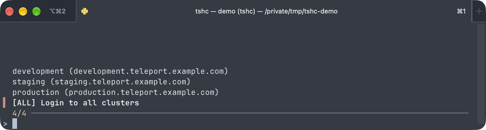
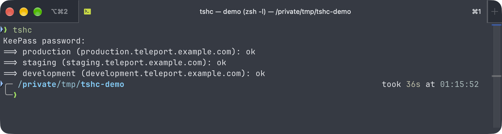

# tshc

[](https://github.com/kuyantus/tshc/actions/workflows/ci.yml)
[](LICENSE)

I built `tshc` because logging in to several Teleport clusters one by one got old. It reads local-login credentials from KeePass, runs `tsh login`, and lets you pick one cluster or sign in to all of them. TOTP can come from KeePass or from an authenticator on your phone.



`tshc` is for Teleport's password-and-OTP login flow. It does not automate SSO or browser-based login.

## What you need

Use a terminal on macOS or Linux with:

- `tsh` installed (in `PATH`, unless you set `tsh_path`)
- A KeePass `.kdbx` database with a `UserName` and `Password` in each Teleport entry

[`fzf`](https://github.com/junegunn/fzf) is optional. With it, you get a searchable cluster list; otherwise, `tshc` shows a numbered list. Homebrew-installed `fzf` is picked up automatically on macOS.

## Install

With Homebrew on macOS or Linux:

```bash
brew install kuyantus/tap/tshc
```

The formula installs `tshc` without Teleport or `fzf`. Keep using the `tsh` version that works with your clusters. To update later, run `brew upgrade kuyantus/tap/tshc`.

## First run

1. Create the initial config:

   ```bash
   tshc
   ```

   `tshc` creates `~/.tshc/teleports.yaml` and stops so you can edit it before any login. It never replaces an existing config.

2. Edit that file. For example, configure two clusters:

   ```yaml
   keepass_db: /path/to/passwords.kdbx
   keepass_password:
     source: prompt

   teleports:
     - name: production
       proxy: teleport.example.com
       keepass_entry: Teleport/production
       totp_source: prompt

     - name: staging
       proxy: staging.teleport.example.com
       keepass_entry: Teleport/staging
       totp_source: prompt
   ```

   Replace the database path, proxies, and KeePass entry paths with your own. Each entry needs its Teleport `UserName` and `Password`. `keepass_entry` is relative to the database's root group: use `group/entry`, or just `entry` for an entry in the root group.

3. Start a login:

   ```bash
   tshc
   ```

   Choose a cluster, enter the KeePass master password, and enter the code from your authenticator when asked. This example works on either operating system. Select `[ALL]` to log in to both clusters in config order, with one master-password prompt for the batch.



The screenshots use demo clusters and credentials, captured in iTerm2 with JetBrains Mono. The batch example generates TOTP codes from KeePass.

## TOTP and other options

Set `totp_source` on each cluster:

- `prompt` asks for a code when `tsh` requests one. Use this for an authenticator on another device.
- `keepass` generates a code from the KeePass entry's `otp` field. That field must contain an `otpauth://totp/...` URI. This is the default if `totp_source` is omitted.

`keepass_password.source` controls the master-password prompt. The example uses `prompt`; the default is `keychain`, which tries macOS Keychain first and prompts on Linux. See [Using Keychain](#using-keychain) to enable it on macOS.

`login_timeout` defaults to `5m` for each `tsh login`, including time spent entering a TOTP code. It starts after KeePass has been opened and the credentials prepared. With `[ALL]`, each cluster gets its own timeout.

`tsh_path` and `fzf_path` default to looking in `PATH`. Set either to an absolute executable path to override it. Use `tsh_args` for extra `tsh login` arguments: for example, `tsh_args: ["--ttl=480"]` requests eight hours, subject to the cluster's limits. The bundled [configuration template](teleports.yaml) includes a `tsh_args` example.

For shared installations or executable permission errors, see [security notes](docs/security.md#executable-validation).

For command help and the installed version:

```bash
tshc --help
tshc --version
```

## Using Keychain

On macOS, change `keepass_password.source` to `keychain` in your config, then save the database's master password:

```bash
tshc keychain set
```

Enter the KeePass master password when prompted in the terminal. The command stores it in your default macOS Keychain. Keep the password out of command arguments and `teleports.yaml`.

When `tshc` reads the saved password, macOS may show a Keychain access dialog for `security`, the system tool used by `tshc`. Choose **Allow / Allow Once** to confirm that read, or **Always Allow** for automatic access. macOS may also ask for your Keychain password, usually your Mac login password. Selecting `[ALL]` needs only one Keychain read for the batch.

If `tshc` cannot read the saved password, it asks for the KeePass master password in the terminal instead.

To stop using Keychain, set `keepass_password.source: prompt` in your config and remove the saved password:

```bash
tshc keychain delete
```

## Install from source

Use Go 1.27.3 or newer:

```bash
go install github.com/kuyantus/tshc@latest
```

Or build and run from a checkout:

```bash
go build -o tshc .
./tshc
```

## Contributing and releases

See [Contributing](CONTRIBUTING.md) for development checks and release steps, and the [changelog](CHANGELOG.md) for recent changes.

## License

[MIT](LICENSE)
